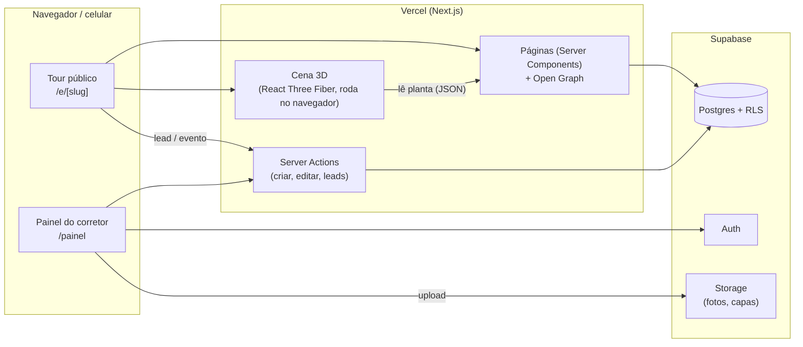

# 02 – Stack e arquitetura

Regra do projeto: **tudo grátis até existir um cliente pagando.** Só começamos a gastar quando houver retorno à vista.

## Tecnologias e por quê

| Camada | Tecnologia | Por que ela | Custo |
|---|---|---|---|
| Linguagem | **TypeScript** | Erros aparecem enquanto você digita, não na tela do cliente. É padrão de mercado e pesa no currículo. | Grátis |
| Framework web | **Next.js** (App Router) | Um projeto só para o site público e o painel. Gera páginas rápidas e com boa prévia no WhatsApp (SSR + Open Graph). É o framework React mais pedido em vaga. | Grátis |
| UI | **React** | Base do Next.js e do React Three Fiber. | Grátis |
| Estilo | **Tailwind CSS** | Estiliza direto no componente, sem arquivos CSS gigantes. Rápido para deixar tudo bonito e responsivo. | Grátis |
| Componentes | **shadcn/ui** | Botões, formulários, modais e tabelas prontos e bonitos. O código fica no nosso projeto, sem depender de biblioteca fechada. | Grátis |
| 3D | **Three.js** via **React Three Fiber** + **drei** | Three.js é o padrão do 3D na web. O React Three Fiber permite escrever a cena 3D como componentes React. O drei traz câmeras, controles, textos 3D e etiquetas prontas. | Grátis |
| Formulários | **react-hook-form** + **Zod** | Valida os dados do formulário e do servidor com o mesmo esquema. Menos bug de dado errado no banco. | Grátis |
| Banco, login e arquivos | **Supabase** (Postgres + Auth + Storage) | Postgres de verdade (SQL é skill essencial), login pronto, armazenamento de fotos e **RLS** (segurança por linha no próprio banco). Plano grátis generoso. | Grátis* |
| Hospedagem | **Vercel** | Feita pelos criadores do Next.js. Cada push gera deploy automático, e cada branch ganha uma URL de pré-visualização. | Grátis* |
| Testes | **Vitest** (unitário) + **Playwright** (navegador) | Vitest é rápido e simples. O Playwright abre um navegador de verdade e clica como um usuário, tanto local quanto no CI. | Grátis |
| Qualidade | **ESLint** + **Prettier** | Padroniza o código e pega erros comuns. | Grátis |
| CI | **GitHub Actions** (sprint posterior) | Roda lint, tipos, testes e build em todo PR. Grátis para repositório público. | Grátis |
| E-mail | **Resend** + **React Email** | Avisa o corretor a cada lead novo. Tem plano grátis com cota mensal de envios e integra fácil com Next.js. A chave fica só no servidor. | Grátis* |
| Fase 2 | **Photo Sphere Viewer** (fotos 360°), **Leaflet + OpenStreetMap** (mapa) | Bibliotecas livres. | Grátis |
| Fase 2 | **API do Claude** (descrição por IA) | Gera texto a partir das fotos. | ⚠️ Paga por uso (centavos por imóvel) |
| Fase 3 | **Gaussian Splatting** (ex.: viewer Spark/gsplat) | 3D fotorrealista a partir de vídeo. O processamento precisa de GPU. | ⚠️ A definir |

### Precisa de framework?
Sim, e ele é o **Next.js**. Ele organiza rotas, páginas, chamadas ao servidor e build. Não precisamos de um backend separado (Express, NestJS etc.): o Next.js faz o papel de backend com **Server Actions** e **Route Handlers**, e o Supabase cuida do banco, do login e dos arquivos.

### Ferramentas na sua máquina
- **Node.js LTS** (22 ou mais novo) e **npm**
- **Git** e **GitHub CLI** (`gh`)
- **VS Code** com as extensões: Claude Code, ESLint, Prettier, Tailwind CSS IntelliSense, GitLens (opcional)
- **Supabase CLI** (versiona o banco com migrations; funciona sem Docker contra o projeto na nuvem)
- **Google Chrome** com a extensão **Claude in Chrome** (testes no navegador pela IA)

## *Limites dos planos grátis (confira sempre no site oficial, eles mudam)

| Serviço | Atenção |
|---|---|
| **Supabase Free** | Banco e storage pequenos (na casa de centenas de MB e ~1 GB), poucos projetos ativos, e o **projeto pausa após ~1 semana sem uso** (reativa com um clique). Por isso: **fotos comprimidas** (WebP) e modelos 3D leves. |
| **Vercel Hobby** | Grátis, mas é **para uso pessoal e não comercial**. Para portfólio e demo está ok. **Quando um cliente pagar**, migramos para o plano Pro ou outra hospedagem. |
| **Resend Free** | Cota mensal e diária de e-mails (confira no site) e, sem domínio próprio verificado, só envia para o e-mail da sua conta. Para a demo isso basta; com um cliente real, verificamos um domínio. |
| **GitHub** | Repositório público: Actions grátis. Repositório privado tem limite de minutos/mês. Para portfólio, **público** é o ideal (mas nunca com segredos!). |

## Arquitetura



### Como o 3D é gerado (sem modelar nada à mão)

1. **Prédio**: com `numero_andares` e `unidades_por_andar`, o código monta blocos (uma "caixa" por unidade) e pinta cada um pelo status: verde = disponível, amarelo = reservado, cinza = vendido.
2. **Unidade**: cada cômodo da tipologia é salvo como um **polígono em metros** (no MVP, retângulos). O código transforma isso em piso + paredes (extrusão) + portas (vãos) e coloca uma etiqueta com nome, área e descrição no centro do cômodo.
3. **Caminhar**: câmera em primeira pessoa a 1,60 m de altura, com colisão simples nas paredes. No celular, um joystick virtual.

Assim o 3D sai **leve** (carrega rápido no 4G) e **gerado a partir de dados**. É um ótimo assunto para explicar em entrevista.

## Estrutura de pastas (planejada)

```
vitrine3d/
├── src/
│   ├── app/
│   │   ├── (public)/e/[slug]/      # tour público
│   │   ├── (painel)/painel/        # área do corretor (protegida)
│   │   ├── (auth)/entrar/          # login
│   │   └── api/                    # route handlers (se necessário)
│   ├── components/
│   │   ├── ui/                     # shadcn/ui
│   │   └── three/                  # componentes 3D (Predio, Unidade, Comodo...)
│   ├── lib/
│   │   ├── supabase/               # clients (browser, server)
│   │   ├── planta/                 # conversão planta JSON -> geometria
│   │   └── validacoes/             # esquemas Zod
│   └── types/                      # tipos gerados do banco
├── supabase/
│   ├── migrations/                 # SQL versionado
│   └── seed.sql                    # dados de exemplo (prédio demo)
├── tests/                          # Playwright (e2e)
├── docs/                           # esta documentação
└── CLAUDE.md                       # regras para o Claude Code
```
