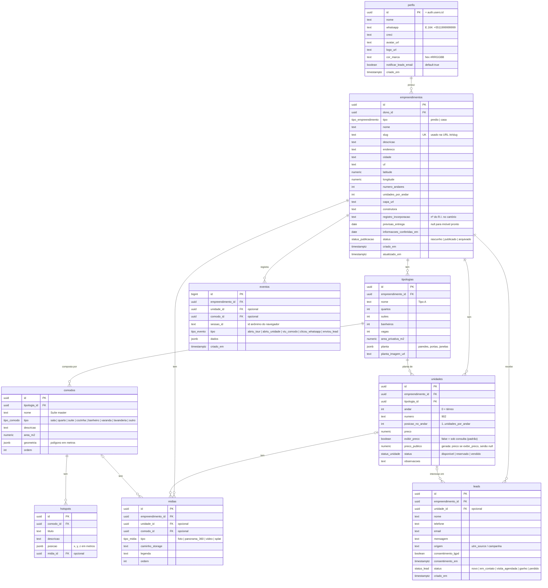

# 03 – Modelagem de dados

Banco: **PostgreSQL (Supabase)**. Tabelas e colunas em **português e snake_case**, chaves `uuid`, datas `timestamptz`.

## Conceitos do domínio

- **Empreendimento**: o que o corretor está vendendo. Pode ser um **prédio** (várias unidades) ou uma **casa** (uma unidade).
- **Tipologia**: uma **planta que se repete**. Num prédio, o "Tipo A, 2 quartos, 65 m²" se repete do 2º ao 10º andar. Cadastrar a planta **uma vez** e reaproveitar economiza muito trabalho do corretor.
- **Cômodo**: sala, quarto, cozinha… Pertence a uma tipologia e tem **geometria** (polígono em metros), área e descrição.
- **Unidade**: o apartamento concreto (ex.: 902), com andar, preço e status. Aponta para uma tipologia.
- **Mídia**: fotos, fotos 360° e vídeos ligados ao empreendimento, unidade ou cômodo.
- **Hotspot**: etiqueta clicável posicionada dentro do 3D ("Piso porcelanato", "Janela antirruído").
- **Lead**: pessoa que demonstrou interesse.
- **Evento**: registro anônimo de navegação (abriu o tour, entrou na unidade, clicou no WhatsApp) que alimenta o analytics e o termômetro de interesse.

## Diagrama ER



## Formato da planta (`tipologias.planta` e `comodos.geometria`)

Tudo em **metros**, com origem (0,0) no canto inferior esquerdo da unidade. No MVP, os cômodos são retângulos desenhados numa grade. O formato aceita polígonos para evoluir depois.

```json
// comodos.geometria
{ "tipo": "poligono", "pontos": [[0,0],[4,0],[4,3.5],[0,3.5]], "pe_direito": 2.7 }

// tipologias.planta  (elementos extras além dos cômodos)
{
  "versao": 1,
  "portas":  [{ "de": [4,1], "ate": [4,1.8] }],
  "janelas": [{ "de": [1,0], "ate": [3,0], "peitoril": 1.0, "altura": 1.2 }]
}
```

O campo `versao` permite mudar o formato no futuro sem quebrar plantas antigas. O formato será validado com **Zod** antes de salvar.

## Regras de integridade

- `empreendimentos.slug` único, minúsculo, só `a-z0-9-`.
- `unidades`: único por `(empreendimento_id, numero)` e por `(empreendimento_id, andar, posicao_no_andar)`.
- `tipologias.empreendimento_id` deve ser o mesmo da `unidade` que a usa: garantido por **chave estrangeira composta** `(tipologia_id, empreendimento_id) → tipologias(id, empreendimento_id)`. Apagar a tipologia deixa a unidade sem tipologia (`on delete set null (tipologia_id)`).
- `leads.consentimento_lgpd` **obrigatório = true** (check constraint) e `consentimento_em` preenchido pelo **banco** (hora do servidor; o visitante não tem permissão nessa coluna). Lead precisa de telefone **ou** e-mail.
- Nenhuma referência cruzada entre empreendimentos: `unidade_id` em `midias`, `leads` e `eventos` usa FK composta com `empreendimento_id`; `comodo_id` em `midias` e `eventos` é checado na policy (`privado.comodo_do_empreendimento`); a mídia de um hotspot precisa ser do mesmo empreendimento do cômodo.
- `unidades.preco` **nunca vai para o visitante** quando `exibir_preco = false`. Como o RLS filtra linhas e não colunas, usamos a **coluna gerada** `preco_publico` (`preco` só quando `exibir_preco = true`) e **GRANT por coluna**: `anon` lê `preco_publico`, nunca `preco` nem `observacoes`. Toda unidade nasce com `exibir_preco = false` (padrão seguro). *(Antes previsto como view `unidades_publicas`; trocado na issue #14 porque uma view comum ignora o RLS e o advisor do Supabase a marca como erro.)*
- **Corretor logado vê só as próprias unidades.** Como o GRANT por coluna vale para o papel inteiro, se `authenticated` pudesse ler unidades publicadas de outros, um concorrente logado leria o `preco` "sob consulta" pela API. Por isso **as páginas públicas (tour) leem com um cliente anônimo, sem os cookies de login** (a criar na Sprint 4).
- `ON DELETE CASCADE` de empreendimento para os filhos; `ON DELETE SET NULL` em referências opcionais (ex.: `leads.unidade_id`).
- `atualizado_em` mantido por trigger.

## Segurança (Row Level Security)

O RLS fica **ativo em todas as tabelas**. A chave pública do Supabase (`anon`) vai para o navegador, então **o banco é quem protege os dados**, não o front-end.

**Padrões adotados nas migrations** (desde a issue #13):
- **Nada nasce acessível pela API.** A migration `fecha_acesso_padrao_da_api` mudou as permissões padrão do schema `public`: **tabelas e sequências** novas não dão acesso nenhum a `anon`/`authenticated`, em **qualquer** ambiente (não depende da opção "Automatically expose new tables" do projeto).
- **Funções são diferentes:** o Postgres dá `EXECUTE` a `PUBLIC` de forma **global**, e isso **não se revoga por schema** (permissões padrão por schema só somam às globais). Regra: **toda função criada numa migration faz `revoke execute on function ... from public, anon, authenticated`**, e só recebe `grant execute` se a API precisar. O teste `supabase/tests/rls/00_privilegios.sql` varre as funções do `public` e do `privado` e **falha** se alguma ficar executável pela API sem estar na lista de liberadas (hoje só `privado.comodo_do_empreendimento`, usada nas policies).
- `GRANT` explícito só das operações necessárias, inclusive **por coluna** quando o visitante não pode ver tudo (ex.: `perfis.notificar_leads_email` não é concedido a `anon`). Ao mudar permissões de uma tabela existente, faça `revoke all ... from anon, authenticated` e conceda de novo só o necessário.
- Policies usam `(select auth.uid())`, que é avaliado uma vez por consulta, e não `auth.uid()` direto, que seria avaliado linha a linha.
- `UPDATE` sempre com `USING` **e** `WITH CHECK`, para ninguém "transferir" uma linha para outro dono.
- Uma policy de leitura por tabela, combinando os casos com `or` (várias policies permissivas pesam no desempenho).
- Funções auxiliares (gatilhos, `SECURITY DEFINER`) ficam no schema **`privado`**, que não é exposto na API, com `set search_path = ''` e sem `EXECUTE` para os papéis da API.
- **`perfis` é semi-público.** A permissão por coluna vale para o papel inteiro, não por linha: para o corretor ler o próprio `notificar_leads_email`, o papel `authenticated` precisa ler essa coluna, então um corretor logado também vê essa preferência (inofensiva) de quem tem empreendimento publicado. **Regra:** dado realmente privado do corretor (plano, cobrança, documentos) **nunca** vai em `perfis`. Ele vai numa tabela própria com policy só do dono.
- O perfil do corretor é criado por gatilho em `auth.users` (`privado.criar_perfil_para_novo_usuario`). O nome inicial vem de `raw_user_meta_data`, que o usuário pode editar, então esse dado **nunca** é usado para decidir permissões.

| Tabela | Corretor (dono) | Visitante anônimo |
|---|---|---|
| `perfis` | lê/edita o próprio | lê nome, whatsapp, creci, foto, marca de quem tem empreendimento publicado (via view) |
| `empreendimentos` | CRUD dos seus | lê se `status = 'publicado'` |
| `tipologias`, `comodos`, `midias`, `hotspots` | CRUD se o empreendimento é seu | lê se o empreendimento está publicado |
| `unidades` | CRUD se o empreendimento é seu; **lê só as suas** | lê se o empreendimento está publicado (sem `preco` e `observacoes`) |
| `leads` | lê/edita os seus | **só insere** (nunca lê) |
| `unidades` (preço) | vê sempre | vê só `preco_publico` (null quando "sob consulta") |
| `eventos` | lê os seus | **só insere** (nunca lê) |

**Storage**: bucket `midias` público para leitura de arquivos de empreendimentos publicados. A escrita só é permitida pelo dono, no caminho `{dono_id}/{empreendimento_id}/...`.

**Escrita do visitante** (`leads` e `eventos`, issue #15): só `INSERT`, só nas colunas de dados (nunca `status`, datas ou `id`), só em empreendimento publicado e **sem nenhum `SELECT`** (nem o próprio lead volta). Os inserts públicos usam o cliente **anônimo** (sem cookies de login), como as demais leituras públicas. O corretor lê os seus, muda só o `status` do lead e pode apagá-lo (pedido de exclusão LGPD); eventos são imutáveis.

**Anti-spam** (leads e eventos): limite de tamanho dos campos (no banco), `sessao_id` com formato fixo, `dados` com até ~2 KB, validação Zod no servidor e, se precisar, rate limit simples por sessão (Sprint 6). ⚠️ É ponto obrigatório de `/security-review`.

## Notificação de lead por e-mail

Quando um lead é inserido, o corretor recebe um e-mail (se `perfis.notificar_leads_email = true`) com nome, contato, unidade de interesse e o **resumo da navegação** daquela sessão (unidades e cômodos vistos, tempo no tour), montado a partir de `eventos`.

- O envio acontece na **Server Action** que salva o lead, depois do insert, usando a API do **Resend** (ver `docs/02`).
- Se o envio falhar, **o lead continua salvo**: o e-mail é um aviso, e o painel é a fonte da verdade.
- O e-mail do corretor vem de `auth.users.email`, que só é acessível no servidor.

## Índices iniciais

- `empreendimentos(slug)` único
- `unidades(empreendimento_id, status)`
- `leads(empreendimento_id, criado_em desc)`
- `eventos(empreendimento_id, criado_em desc)` e `eventos(sessao_id)`

## Migrations

- Cada mudança no banco é um arquivo em `supabase/migrations/` (gerado com `supabase migration new <nome>`).
- **Nunca** alterar o banco pelo painel web sem criar a migration correspondente.
- `supabase/seed.sql` cria um **prédio demo** (10 andares, 4 unidades por andar, 2 tipologias) para desenvolvimento e para a demo do portfólio. Todos os dados são fictícios.
  - **Fonte única:** `supabase/seed/residencial-demo.json` (corretora, empreendimento, tipologias e cômodos). As 40 unidades são geradas por regra (tipologia por posição, preço por andar, 9º e 10º andares "sob consulta", status pela mesma fórmula do 3D de exemplo).
  - **Gerar:** `npm run db:seed:gerar` (escreve o `seed.sql`; não edite o SQL à mão). Um teste unitário falha se o `seed.sql` estiver desatualizado em relação ao JSON, e outro valida todas as geometrias com o esquema Zod (`src/lib/validacoes/planta.ts`).
  - **Aplicar no dev:** `npm run db:seed` (`supabase db push --remote --include-seed`). É repetível: IDs fixos e `on conflict do update`.
  - A corretora demo não tem senha (não faz login). Os campos de token de `auth.users` vão como `''`, porque o Auth do Supabase não lida bem com `null` neles.
- Os tipos TypeScript são gerados do banco com `supabase gen types typescript`.
- **Supabase CLI v3** trabalha no banco **local por padrão**. Para o projeto na nuvem, use `--remote` (ex.: `supabase db push --remote`); a CLI pede confirmação antes de alterar o banco hospedado.
- **Tabelas novas não são expostas na Data API automaticamente** (mudança do Supabase em 2026). Toda migration que cria tabela acessada pelo app precisa de: `enable row level security`, `grant` explícito **só** das operações necessárias para `anon`/`authenticated`, e as policies correspondentes.

### Tabelas fora do modelo do produto
- `saude` (Sprint 1, issue #6): health check da conexão, lida pela página `/lab/supabase`. Uma linha (`'conectado'`), leitura pública, sem escrita pela API. Pode ser removida quando a página de laboratório não for mais necessária.
