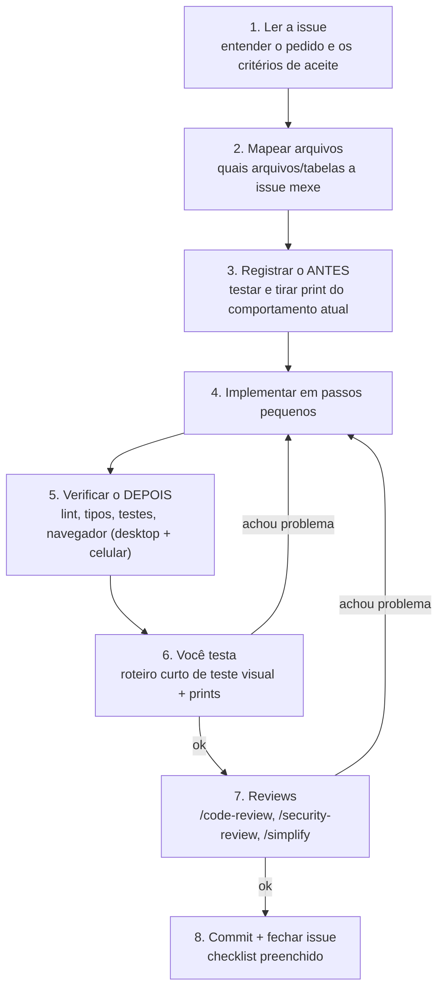

# 04 – Fluxo de trabalho

Objetivo: **o mínimo de margem de erro.** Nada é dado como pronto sem ser visto funcionando antes e depois, testado no navegador e revisado.

## Organização no GitHub

- **Issues**: cada tarefa é uma issue com contexto, critérios de aceite e roteiro de teste (ver templates em `.github/ISSUE_TEMPLATE`).
- **Milestones**: uma por sprint (`Sprint 1 – Ambiente`, `Sprint 2 – …`).
- **Labels**: `tipo:feature`, `tipo:bug`, `tipo:chore`, `tipo:docs`, `tipo:estudo`, `area:3d`, `area:painel`, `area:tour`, `area:banco`, `area:infra`, `prioridade:alta`, `seguranca`.
- **GitHub Projects** (quadro Kanban): `Backlog → A fazer (sprint) → Em andamento → Em teste → Feito`.

## O ciclo de cada issue (passo a passo)



### 1. Ler a issue
O Claude Code lê a issue (`gh issue view <n>`) e confirma em uma frase o que vai fazer. Se algo estiver ambíguo, **pergunta antes de codar**.

### 2. Mapear os arquivos
Antes de alterar, listar **quais arquivos serão criados ou alterados** e por quê. Se a lista crescer demais, a issue provavelmente precisa ser dividida.

### 3. Registrar o ANTES
- Rodar o projeto (`npm run dev`) e abrir a tela afetada no navegador (**Claude in Chrome** ou Playwright).
- Tirar print e anotar o comportamento atual (inclusive o bug, se for bug).
- Se for bug: escrever **primeiro um teste que falha** reproduzindo o problema.

### 4. Implementar
- Passos pequenos, um assunto por vez.
- Mudança no banco = migration nova + atualizar `docs/03-modelagem-de-dados.md` + regenerar tipos.

### 5. Verificar o DEPOIS
Sempre, nesta ordem:
```bash
npm run lint
```
```bash
npm run typecheck
```
```bash
npm run test
```
```bash
npm run build
```
Depois, no navegador:
- Abrir a tela, repetir o fluxo do roteiro de teste e tirar print (**desktop e celular**, 390 px de largura).
- Olhar o console do navegador: **zero erros novos**.
- Para telas 3D: conferir se carrega, se dá para girar e caminhar, e se não travou no celular.

### 6. Você testa (teste visual humano)
O Claude envia:
- **Prints do antes e depois**
- **Roteiro de teste curto**, por exemplo:
  > 1. Abra http://localhost:3000/e/predio-demo
  > 2. Toque no 9º andar → o prédio deve "cortar" e mostrar 4 unidades
  > 3. Toque na unidade 902 → deve abrir a vista de cima com as etiquetas

Você testa e responde **ok** ou descreve o problema.

### 7. Reviews automáticos
| Comando | Quando |
|---|---|
| `/code-review` | **Sempre**, antes de fechar a issue |
| `/security-review` | Sempre que mexer em **login, RLS/policies, uploads, formulários públicos (leads), variáveis de ambiente, Server Actions** |
| `/simplify` | Quando a mudança ficou grande ou com cara de repetida |

Os problemas encontrados são corrigidos (volta ao passo 4) ou viram uma nova issue, se forem fora do escopo.

### 8. Commit e fechamento
- Mensagem no padrão **Conventional Commits**, citando a issue:
  - `feat(tour): corta o prédio no andar selecionado (#23)`
  - `fix(painel): corrige validação do preço (#31)`
  - `chore(infra): configura ESLint e Prettier (#5)`
  - `docs: atualiza modelagem de dados (#8)`
- `Closes #23` no corpo do commit fecha a issue automaticamente.
- Antes de fechar, marcar todos os itens do **checklist de pronto** (abaixo).

## Definição de Pronto (DoD)

- [ ] Critérios de aceite da issue atendidos
- [ ] `lint`, `typecheck`, `test` e `build` passando
- [ ] Testado no navegador (desktop + celular), sem erros no console
- [ ] Prints antes/depois anexados na issue
- [ ] Teste visual aprovado por você
- [ ] `/code-review` feito (e `/security-review`, quando aplicável)
- [ ] Documentação atualizada, se mudou algo de banco, stack ou fluxo
- [ ] Nenhum segredo (`.env`, chaves) no commit

## Branches

**Regra atual:** depende do risco da issue.

| Tipo de issue | Onde trabalhar |
|---|---|
| Ajuste de ambiente, configuração, docs, testes, tarefas pequenas (`chore`, `docs`, `estudo`) | **Direto na `main`** |
| Funcionalidade, bug, ou qualquer coisa que exija mais cuidado: banco/migrations, RLS, login, uploads, formulários públicos, 3D (`feature`, `fix`, label `seguranca`) | **Branch a partir da `main` + Pull Request** |

Fluxo com branch:
```bash
git switch main
```
```bash
git pull
```
```bash
git switch -c feat/7-poc-3d
```
Depois do commit: `git push -u origin feat/7-poc-3d` e `gh pr create`. O PR descreve o que mudou e tem `Closes #N` no corpo. O merge na `main` acontece **depois** do seu ok e das verificações do PR passarem.

**Depois (sprint de CI):**
- `main` protegida: só entra via **Pull Request**.
- Branch por issue: `feat/<n>-descricao`, `fix/<n>-descricao`, `chore/<n>-descricao`.
- **GitHub Actions** em todo PR: lint, typecheck, testes, build e Playwright.
- A Vercel gera uma **URL de preview** por PR para testar antes do merge.

## Trabalhando com o Claude Code

Prompt padrão para começar uma issue:
> "Vamos trabalhar na issue #N. Siga o fluxo do `docs/04-fluxo-de-trabalho.md`: leia a issue, me mostre os arquivos que vai mexer, registre o antes, implemente, verifique o depois e me mande o roteiro de teste."

O arquivo `CLAUDE.md` na raiz do projeto guarda essas regras, para o Claude seguir em toda sessão.

## Segredos e variáveis de ambiente

- `.env.local` **nunca** vai para o Git (está no `.gitignore`).
- `.env.example` lista as variáveis **sem valores**.
- A `SUPABASE_SERVICE_ROLE_KEY` (se um dia for usada) **nunca** pode ir para o navegador nem ter o prefixo `NEXT_PUBLIC_`.
