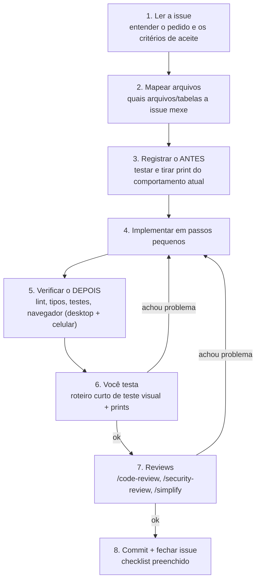

# 04 – Fluxo de trabalho

Objetivo: **o mínimo de margem de erro.** Nada é dado como pronto sem ser visto funcionando antes e depois, testado no navegador e revisado.

## Organização no GitHub

- **Issues**: cada tarefa é uma issue com contexto, critérios de aceite e roteiro de teste (ver templates em `.github/ISSUE_TEMPLATE`).
- **Milestones**: uma por sprint (`Sprint 1 – Ambiente`, `Sprint 2 – …`).
- **Labels**: `tipo:feature`, `tipo:bug`, `tipo:chore`, `tipo:docs`, `tipo:estudo`, `area:3d`, `area:painel`, `area:tour`, `area:banco`, `area:infra`, `prioridade:alta`, `seguranca`.
- **GitHub Projects** (quadro Kanban): `Backlog → A fazer (sprint) → Em andamento → Em teste → Feito`.

## O ciclo de cada issue (passo a passo)



### 1. Ler a issue
O Claude Code lê a issue (`gh issue view <n>`) e confirma em uma frase o que vai fazer. Se algo estiver ambíguo, **pergunta antes de codar**.

### 2. Mapear os arquivos
Antes de alterar, listar **quais arquivos serão criados ou alterados** e por quê. Se a lista crescer demais, a issue provavelmente precisa ser dividida.

### 3. Registrar o ANTES
- Rodar o projeto (`npm run dev`) e abrir a tela afetada no navegador (**Claude in Chrome** ou Playwright).
- Tirar print e anotar o comportamento atual (inclusive o bug, se for bug).
- Se for bug: escrever **primeiro um teste que falha** reproduzindo o problema.

### 4. Implementar
- Passos pequenos, um assunto por vez.
- Mudança no banco = migration nova + atualizar `docs/03-modelagem-de-dados.md` + regenerar tipos.

### 5. Verificar o DEPOIS
Sempre, nesta ordem:
```bash
npm run lint
```
```bash
npm run typecheck
```
```bash
npm run test
```
```bash
npm run test:e2e
```
> **Para não perder tempo:** durante o desenvolvimento, rode só os testes da parte mexida (`npx playwright test tests/unidades.spec.ts`). A suíte inteira roda **uma vez**, antes do merge. Ela testa o site compilado (`build` + `start`), que é mais rápido que o servidor de dev; para usar o dev, `E2E_DEV=1 npm run test:e2e` (no PowerShell: `$env:E2E_DEV=1; npm run test:e2e`).
```bash
npm run test:rls   # quando a issue mexe no banco (migrations, RLS)
```
```bash
npm run build
```
Depois, no navegador:
- Abrir a tela, repetir o fluxo do roteiro de teste e tirar print (**desktop e celular**, 390 px de largura).
- Olhar o console do navegador: **zero erros novos**.
- Para telas 3D: conferir se carrega, se dá para girar e caminhar, e se não travou no celular.

### 6. Você testa (teste visual humano)
O Claude envia:
- **Prints do antes e depois**
- **Roteiro de teste curto**, por exemplo:
  > 1. Abra http://localhost:3000/e/predio-demo
  > 2. Toque no 9º andar → o prédio deve "cortar" e mostrar 4 unidades
  > 3. Toque na unidade 902 → deve abrir a vista de cima com as etiquetas

Você testa e responde **ok** ou descreve o problema.

### 7. Reviews automáticos
| Comando | Quando |
|---|---|
| `/code-review` | **Sempre**, antes de fechar a issue |
| `/security-review` | Sempre que mexer em **login, RLS/policies, uploads, formulários públicos (leads), variáveis de ambiente, Server Actions** |
| `/simplify` | Quando a mudança ficou grande ou com cara de repetida |

Os problemas encontrados são corrigidos (volta ao passo 4) ou viram uma nova issue, se forem fora do escopo.

### 8. Commit e fechamento
- Mensagem no padrão **Conventional Commits**, citando a issue:
  - `feat(tour): corta o prédio no andar selecionado (#23)`
  - `fix(painel): corrige validação do preço (#31)`
  - `chore(infra): configura ESLint e Prettier (#5)`
  - `docs: atualiza modelagem de dados (#8)`
- `Closes #23` no corpo do commit fecha a issue automaticamente.
- Antes de fechar, marcar todos os itens do **checklist de pronto** (abaixo).

## Definição de Pronto (DoD)

- [ ] Critérios de aceite da issue atendidos
- [ ] `lint`, `typecheck`, `test` e `build` passando
- [ ] Testado no navegador (desktop + celular), sem erros no console
- [ ] Prints antes/depois anexados na issue
- [ ] Teste visual aprovado por você
- [ ] `/code-review` feito (e `/security-review`, quando aplicável)
- [ ] Documentação atualizada, se mudou algo de banco, stack ou fluxo
- [ ] Nenhum segredo (`.env`, chaves) no commit

## Como o CI funciona (GitHub Actions)

A cada PR e a cada push na `main`, o GitHub roda sozinho o workflow `.github/workflows/ci.yml` (check **`verificar`**), nesta ordem:

1. `npm ci` (instala exatamente o que está no `package-lock.json`);
2. `npm run format:check` (Prettier), `npm run lint`, `npm run typecheck`;
3. `npm run test` (Vitest);
4. `npm run build` (Next.js).

Regras do CI:

- **Nenhum segredo:** o build usa valores de exemplo para as variáveis públicas; o workflow só tem permissão de leitura (`contents: read`). Chave real nunca entra no CI.
- **Rodada nova cancela a antiga** no mesmo PR (economiza minutos grátis).
- **Para ver o resultado:** aba *Checks* do PR ou `gh pr checks <número>` (`--watch` espera terminar).
- **Vermelho = corrigir.** Nunca fazer merge com o CI vermelho; abrir o log do passo que falhou, corrigir, dar push (o CI roda de novo).

**Divisão do trabalho (a partir da Sprint 7):** o CI roda a suíte automática; no computador, durante a issue, rodamos só `lint`, `typecheck` e os testes da parte mexida. `/code-review` e `/security-review` continuam sendo feitos antes do merge: o CI confere se funciona, não se está bem feito ou seguro.

### Job "banco e navegador" (issue #85)

Um segundo job, no mesmo workflow, testa o banco e as telas **sem nenhuma chave do banco de desenvolvimento**:

1. sobe um **Supabase local** (Docker) dentro da máquina do CI, aplica todas as migrations e o seed (Residencial Demo);
2. roda `npm run test:rls` (permissões no banco);
3. roda `npm run test:e2e` inteiro (desktop e iPhone 13), contra o site compilado apontando para esse banco, incluindo a **jornada completa** (`tests/jornada.spec.ts`: prédio → unidade → caminhar → formulário → lead no painel → situação → apagar);
4. se algo falhar, guarda o relatório do Playwright, os prints e o "replay" como **artefato** (página do CI > *Summary* > *Artifacts* > `relatorio-playwright`). Para abrir: descompactar e rodar `npx playwright show-report <pasta>/playwright-report`.

O banco some no fim: cada rodada começa limpa. Quem escolhe o banco nos scripts de teste é a variável `SUPABASE_DB_LOCAL=1` (`tests/db-target.ts`); sem ela, os testes usam o projeto na nuvem, como antes.

### Rodar o mesmo banco local no seu computador

Precisa do Docker Desktop aberto. No PowerShell, dentro da pasta do projeto:

```powershell
# 1) Sobe o Supabase local (a 1ª vez baixa as imagens, demora alguns minutos)
supabase start -x studio,edge-runtime,logflare,vector,imgproxy,realtime,supavisor,mailpit,postgres-meta
# 2) Mostra a URL e as chaves LOCAIS (de demonstração, iguais em todo computador)
supabase status
# 3) Aponta os testes e o site para ele (vale só para este terminal)
$env:SUPABASE_DB_LOCAL="1"
$env:NEXT_PUBLIC_SUPABASE_URL="http://127.0.0.1:54321"
$env:NEXT_PUBLIC_SUPABASE_PUBLISHABLE_KEY="<PUBLISHABLE_KEY do status>"
$env:SUPABASE_SECRET_KEY="<SECRET_KEY do status>"
$env:RESEND_API_KEY=""   # e-mail desligado nos testes
# 4) Testa
npm run test:rls
npx playwright test tests/jornada.spec.ts
# 5) Desliga quando acabar (os dados locais somem com --no-backup)
supabase stop --no-backup
```

As variáveis do terminal valem mais que as do `.env.local`, então o seu `.env.local` (da nuvem) não precisa mudar. Para voltar à nuvem, feche o terminal.

**Divisão do trabalho:** o CI roda tudo (RLS e a suíte e2e inteira). No computador, durante a issue, basta `lint`, `typecheck`, `test` e o spec da parte mexida; o resto fica com o CI.

## Branches

**Regra atual (desde a issue #83): a `main` está protegida. TUDO entra por Pull Request**, inclusive docs, configuração e testes. Um `git push` direto na `main` é recusado pelo GitHub.

O que a proteção exige (ativada com `gh api` em `branches/main/protection`):

| Regra | Efeito |
|---|---|
| Pull Request obrigatório | Nada entra na `main` sem PR |
| Check **`verificar`** (CI) verde | O botão de merge fica bloqueado com o CI vermelho ou ainda rodando |
| Sem *force push* e sem apagar a `main` | Ninguém reescreve nem apaga o histórico |
| Histórico linear | Só *squash merge* (um commit por PR) |
| Vale também para administradores | Nem o dono da conta fura a regra por engano |

Uma branch por issue: `feat/<n>-descricao`, `fix/<n>-descricao`, `chore/<n>-descricao`.

Fluxo:
```bash
git switch main
```
```bash
git pull
```
```bash
git switch -c feat/7-poc-3d
```
Depois do commit: `git push -u origin feat/7-poc-3d` e `gh pr create`. O PR descreve o que mudou e tem `Closes #N` no corpo. Em seguida **esperar o CI ficar verde** (`gh pr checks --watch`) e só então fazer o merge (`gh pr merge --squash --delete-branch`). Se o CI ficar vermelho: abrir o log do passo que falhou, corrigir e dar push; nunca contornar a regra.

A Vercel gera uma **URL de preview** por PR para testar antes do merge.

**Se um dia o GitHub Actions ficar fora do ar** e a regra impedir um conserto urgente: o dono do repositório pode desativar a proteção em *Settings → Branches* (ou `gh api -X DELETE repos/{owner}/{repo}/branches/main/protection`) e **reativar logo depois**. Isso é exceção; não é o fluxo normal.

## Trabalhando com o Claude Code

Prompt padrão para começar uma issue:
> "Vamos trabalhar na issue #N. Siga o fluxo do `docs/04-fluxo-de-trabalho.md`: leia a issue, me mostre os arquivos que vai mexer, registre o antes, implemente, verifique o depois e me mande o roteiro de teste."

O arquivo `CLAUDE.md` na raiz do projeto guarda essas regras, para o Claude seguir em toda sessão.

## Segredos e variáveis de ambiente

- `.env.local` **nunca** vai para o Git (está no `.gitignore`).
- `.env.example` lista as variáveis **sem valores**.
- A `SUPABASE_SERVICE_ROLE_KEY` (se um dia for usada) **nunca** pode ir para o navegador nem ter o prefixo `NEXT_PUBLIC_`.
